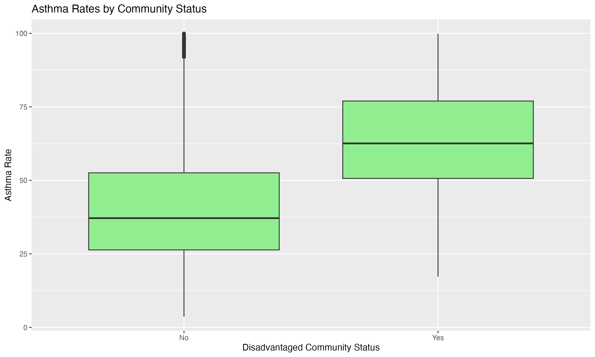
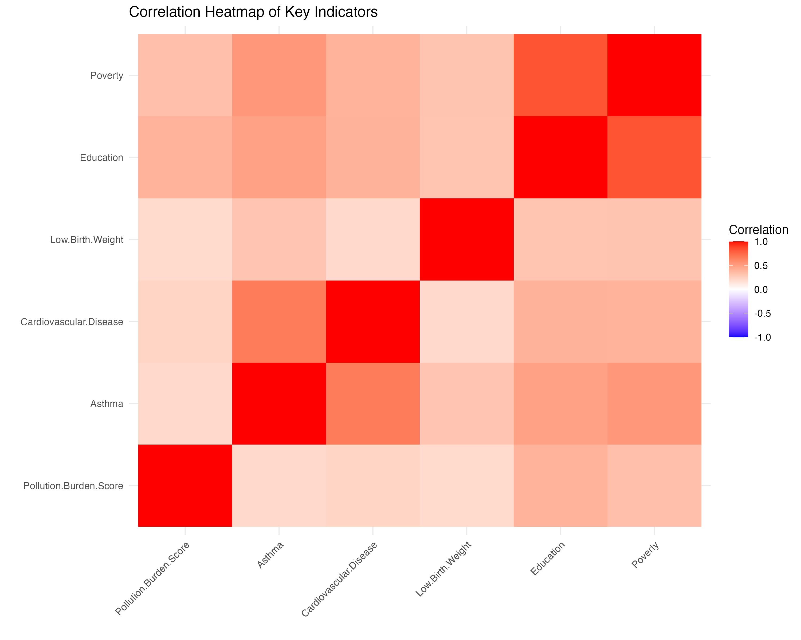
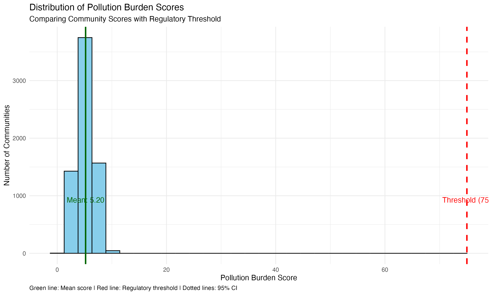
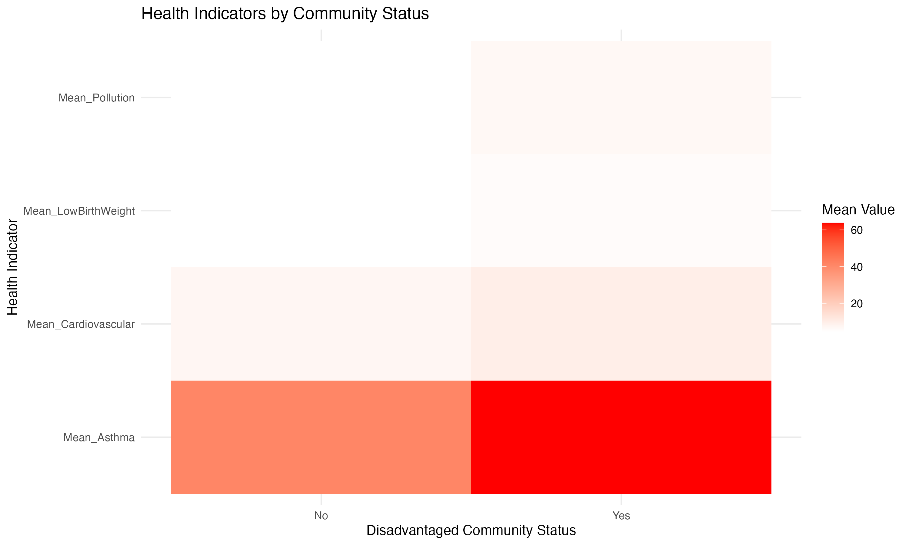
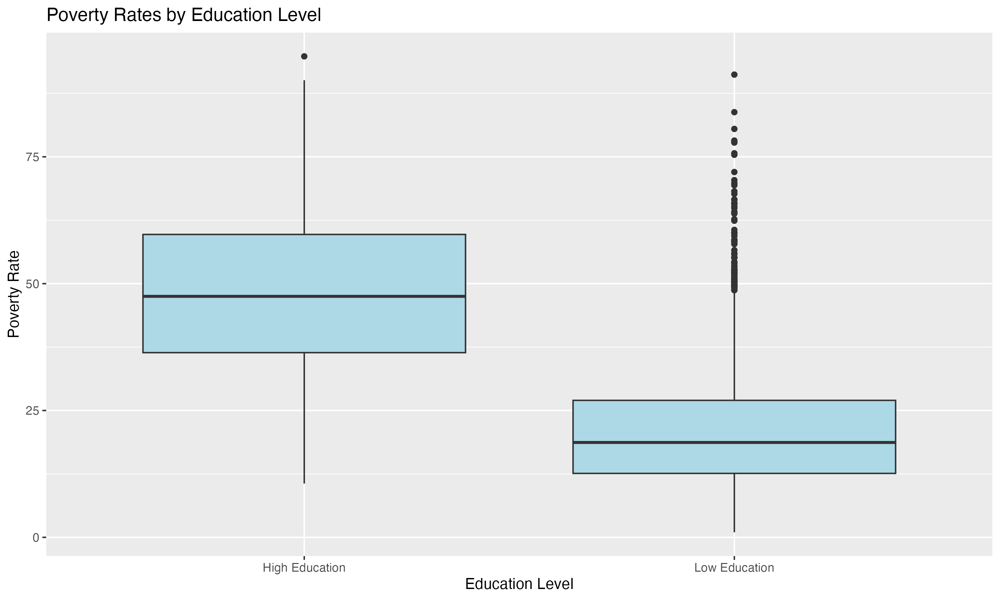

# R Practice Series + CalEnviroScreen Final Project

**By Dev Panchal, Northeastern University — ALY6010, Feb–Mar 2025.**

This repo has two parts that belong together. First, a six-week R practice series that builds the skills. Second, a final project that uses those skills on a real public-health question in California. If you only read this page, you should understand what was asked, what was found, and why it matters — no code needed.

**In plain English:** Some California communities carry far more pollution and far worse health outcomes than others. This project tests whether that pattern is real, how strong it is, and which pollutants and social factors track with it.

**Tools:** R, tidyverse, ggplot2, car (for VIF / multicollinearity checks), cowplot, gridExtra.

**How it flows:** Data → Explore distributions and relationships → Test hypotheses → Model health outcomes → Findings and conclusion. The final code is in `calenviroscreen-final-traffic-pollution-health-disadvantage/`, the practice code is in the six descriptive practice folders, and the datasets are in `data/` (one file per project, named exactly as the code reads it).

---

## Part 1 — R Practice Series, Weeks 1–6

**What it is:** Weekly R practice and projects, building from basic R work in Week 1 to a full Week 6 project. Each week folder contains the code and its report, so you can see the progression, not just the final answer.

- COVID-19 Deaths by Condition, Age and Season: Cleaning and First Charts: `covid-19-deaths-cleaning-and-first-charts/` — RPractice, 23 Feb 2025. **Files:** `RPractice_Panchal_23022025.R`, `RPractice_Panchal_23022025.docx`. Dataset: `data/tempdata.csv`.
- Food Affordability in California: Does Income Decide What Food Costs?: `food-affordability-california-income-and-cost/` — RPractice, 28 Feb 2025. **Files:** `RPractice_Panchal_28022025.R`, `RPractice_Panchal_28022025.docx`. Dataset: `data/foodAfford.csv`.
- COVID-19 Mortality by Age: How Deaths Distribute, and the Pneumonia Link: `covid-19-mortality-by-age-and-pneumonia/` — R Project 3. **Files:** `RProject3_Panchal_Code.R`, `RProject3_Panchal_Report.docx`. Dataset: `data/Corona_Data.csv`.
- Cats and Sleep: Do Male Cats Weigh More, and Does Meditation Improve Sleep?: `cats-bodyweight-and-meditation-sleep-quality/` — RPractice 4, 14 Mar 2025. **Files:** `RPractice4_Panchal_14032025_Code.R`, `RPractice4_Panchal_14032025_Report.docx`. No external dataset — cats data comes from R's MASS package and the sleep scores are defined in the code.
- DeepSeek vs ChatGPT: Which AI Platform Keeps Users Coming Back?: `deepseek-vs-chatgpt-user-retention/` — R Project 5, 21 Mar 2025. **Files:** `RProject5_Panchal_03212025_Code.R`, `RProject5_Panchal_03212025_Report.docx`. Dataset: `data/deepseek_vs_chatgpt.csv`.
- Electric Cars: How Model Year and Maker Shape Driving Range: `electric-car-range-by-year-and-maker/` — R Project 6, 27 Mar 2025, code + PDF report. **Files:** `RProject6_Code_03272025.R`, `RProject6_Report_03272025.pdf`. Dataset: `Electric_Vehicle_Population_Data.csv` (57.5 MB) — pending direct upload to `data/` (see note below).

**What to take from it:** The practice series is the training ground — data cleaning, descriptive statistics, plots, and reporting in R — that the final project then applies to CalEnviroScreen.

---

## Part 2 — CalEnviroScreen Final Project: Environment, Health and Disadvantage in California

**Data:** `data/calenviroscreen.csv` — CalEnviroScreen environmental and health indicators for California communities. The same file is used across Milestones 1–2 and the final analysis, and is included once here so the code runs.

**All datasets in `data/`:** `tempdata.csv` (Week 1), `foodAfford.csv` (Week 2), `Corona_Data.csv` (Week 3), `deepseek_vs_chatgpt.csv` (Week 5), `Electric_Vehicle_Population_Data.csv` (Week 6, pending — see below), `calenviroscreen.csv` (final project). Week 4 needs no dataset file. Note on the Week 6 dataset: the original Electric Vehicle file is 57.5 MB, above the 50 MB limit for transferring it from the Mac to this workspace, so it is not in `data/` yet — it can be added directly to `data/` on GitHub (under GitHub's 100 MB single-file limit) from the original Mac file, after which the Week 6 code will run as written. Each practice code reads its dataset by the exact filename above, so copy the `data/` folder alongside the project folder you want to run.

**Milestones:**
- CalEnviroScreen First Look: Pollution, Health and Disadvantage in California — Milestone 1 (Week 2): `calenviroscreen-first-look-pollution-health-disadvantage/` — first exploration. Pollution Burden Score looked relatively normally distributed, CES 3.0 Scores showed clear disparities between communities, and disadvantaged communities already showed consistently higher health burden.
- CalEnviroScreen Hypothesis Tests: Traffic, Pollution and Health — Milestone 2 (Week 4): `calenviroscreen-hypothesis-tests-traffic-pollution-health/` — hypothesis tests, plus the plots in `images/`.
- CalEnviroScreen Final: Traffic, Pollution and Health in Disadvantaged Communities — Final (Week 6): `calenviroscreen-final-traffic-pollution-health-disadvantage/` — full code, PDF report and presentation, dated 29 Mar 2025.

### Research Question 1 — Traffic and Asthma

**Question:** Do communities with high traffic density have higher asthma rates than communities with low traffic density?

**What I did:** Split communities into High Traffic (above the 75th percentile) and Low Traffic (below the 25th percentile), compared asthma rates with a t-test, checked normality, calculated Cohen's d for effect size, and ran correlation and regression of asthma on traffic.

**Findings:**
- Higher asthma rates in disadvantaged communities, and in the high-traffic group.
- Traffic–asthma correlation: **0.43**
- Traffic effect size: **Cohen's d = 1.02** — a large effect, not just a statistically significant one.

**Conclusion in plain English:** Where traffic is heaviest, asthma is clearly higher. This is not a weak trend hiding in a large dataset; the size of the difference is large enough to matter for public-health planning.

### Research Question 2 — Environmental Hazards and Cardiovascular Disease

**Question:** Which pollutants track most closely with cardiovascular disease, and do they hold up together in one model?

**What I did:** Correlations for each pollutant against cardiovascular disease, then a multiple regression with diesel PM, ozone and PM2.5 together, checking multicollinearity with VIF.

**Findings — correlations with cardiovascular disease, verified from the final code:**
- Diesel PM: **0.38**
- PM2.5: **0.31**
- Ozone: **0.24**

Most relationships in the project showed **p-values < 0.05**. The environmental model explained about **R² = 0.276** of the variation in cardiovascular disease — meaningful, but also a reminder that other factors matter too.

**Other patterns that matter:**
- Strong correlation between education and poverty levels, and a strong negative correlation between education and poverty in the Milestone 2 tests.
- Pollution Burden differed significantly from the threshold of 75 in the one-sample test.
- Geographic clustering of environmental hazards, and multiple pollutant exposure in disadvantaged areas — communities do not face one pollutant at a time.

### Overall conclusion

Disadvantage, pollution and health move together in California in this dataset. Disadvantaged communities face higher pollution burden and higher asthma and cardiovascular burden, traffic density is strongly linked to asthma (r = 0.43, d = 1.02), and diesel PM is the strongest single pollutant correlate of cardiovascular disease (r = 0.38). The honest limit is also clear: the environmental model explains about 27.6% of cardiovascular variation, so pollution alone does not explain everything — socioeconomic factors, healthcare access and other exposures belong in the next step.

---

## How to run it yourself (3 steps)

1. Install R and RStudio, and install tidyverse, ggplot2, car, cowplot and gridExtra.
2. Open `calenviroscreen-final-traffic-pollution-health-disadvantage/FinalProject_Code_Panchal_03292025.R`, make sure `data/calenviroscreen.csv` is where the code expects it — the code reads `calenviroscreen.csv` with `;` as the separator — and run it.
3. The code saves plots to a `plots/` folder. The five plots already in `images/` show the Milestone 2 / final visualisations, so you can compare your output with the originals.

## What is NOT in this repo

Working copies that duplicate the Submit Part files, professor material and books, and the Week 1–3 datasets folder — those are not deliverables, so they were left out on purpose. `calenviroscreen.csv` is included once, in `data/`, not duplicated in Milestone 1, Milestone 2 and Final folders. Nothing here contains personal, confidential or client data; CalEnviroScreen is a public California dataset.
